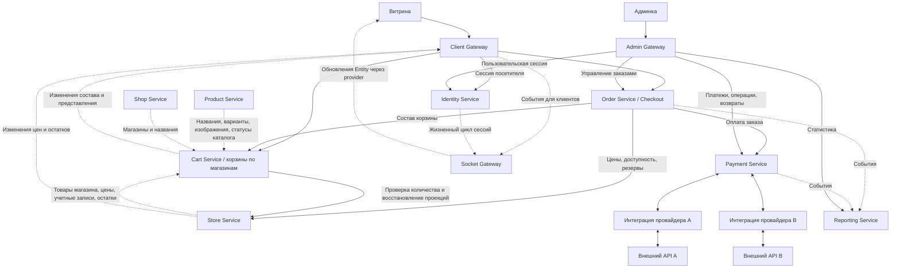

# RFC Корзина, оформление заказа и платежи

- Статус: границы сервисов и концептуальный контракт Cart согласованы 2026-11-15; детальные API и контракты Order/Payment проектируются.
- Дата: 2026-11-15.
- Уточнение по аудиту: 2026-11-15; восстановление оформления, подтверждение цены, версии и события Store уточнены без пересмотра принятых продуктовых правил.
- Пересмотр границы Cart: 2026-11-16; отдельная корзина каждого магазина, одно оформление создает один заказ. Магазины — точки единого владельца.
- Проработка проекций и доступности: 2026-11-16; пользователь подтвердил сохранение скрытых товаров с пометкой «Временно недоступен», отключенных/архивированных — «Товар больше не продается». Остальные рекомендации отмечены отдельно.
- Идентификация владельца: 2026-11-16; согласовано одно поле owner_uuid, нормализованный контекст Identity и уникальность активной корзины по (owner_uuid, shop_uuid).
- Реализация Cart: 2026-11-16; локальный Cart Service, миграция 14 таблиц, команды, проекции и recovery. Контракты и проверки — в [Cart README](../../backend/service/sellgar.cart.service/README.md).
- Область: Cart, Order/Checkout, Payment, интеграции платежных провайдеров, управление операциями и статистика.
- Назначение: целевая архитектура; документ не означает, что перечисленные сервисы уже реализованы.

## Основание и границы работы

Покупатель собирает корзину, оформляет заказ и оплачивает его через внешнего
платежного провайдера. Оператор управляет заказами и платежными операциями
в отдельном разделе админки и получает статистику.

Согласована архитектура без отдельного Billing Service. Текущая задача магазина —
прием платежей и возвраты. Подписки, периодические начисления и выставление
счетов как отдельный продукт этим RFC не проектируются.

Магазины — точки единого владельца, используемые для разделения учета,
например в разных районах города. Каждый магазин имеет отдельную корзину
покупателя. Оформление, остатки, суммы и аналитика привязаны к одному магазину;
совместное оформление товаров разных магазинов не предусматривается.

Первый этап ограничивался документацией workspace в ветке `master`.
По отдельному запросу пользователя 2026-11-16 реализован Cart Service.
Order/Payment, внедрение гостевого ownerUuid в Identity, приватная адресация
Socket и UI остаются отдельными задачами. Публикация в Git не выполнялась.
Приемка документа: схема, владельцы данных, открытые вопросы и ссылки
доступны из индекса; Markdown не содержит битых локальных ссылок и ошибок diff.

## Согласованная схема

Стрелки обозначают зависимости и потоки данных. Конкретные команды, запросы,
события и transport определяются при проектировании контрактов. Пунктирные
стрелки показывают асинхронные потоки. Поток Cart адресуется владельцу
корзины; поток Store проходит проверку допустимости публичных данных витрины.

## Владение данными и правилами

| Компонент | Ответственность |
|---|---|
| Cart | Корзина аккаунта или гостевой сессии в конкретном магазине: учетные записи Store этого магазина, количество и состояние передачи выбранных позиций в оформление. Принятые правила приведены ниже. |
| Order / Checkout | Проверка условий покупки, фиксация состава и цен заказа, координация резервов и оплаты, жизненный цикл заказа. Checkout первоначально является частью Order. |
| Store | Текущие цены, остатки и резервы учетных записей. Механизм резервов необходимо реализовать до рабочего checkout. |
| Payment | Платежи, попытки оплаты, операции, их история и сверка состояния с провайдерами. |
| Интеграция провайдера | Внешний API конкретного банка/PSP, проверка webhook, запрос внешнего состояния, нормализация ответов и отчетов. |
| Reporting | Производные представления, агрегаты, статистика и экспорт на основании событий владельцев данных. |
| Identity | Гостевые и пользовательские сессии: выдача credentials, проверка, продление, отзыв и проверенный контекст с единым ownerUuid. Гарантирует стабильность и уникальность идентификатора владельца. |
| Socket Gateway | Адресная доставка, replay и прекращение приватной доставки при завершении сессии. Не владеет составом корзины и ценами. |
| Client Gateway / Admin Gateway | Авторизация доступа, transport и композиция ответов для соответствующего интерфейса. Предметные правила принадлежат сервисам. |

Покупаемая позиция должна идентифицировать учетную запись Store (`recordUuid`),
а не только каталоговый товар или предложение. Итоговый заказ сохраняет
согласованные снимки состава, названий и цен; последующее изменение каталога
не переписывает историю заказа.

Граница интеграции проходит по провайдеру. Один провайдер может обслуживать
несколько методов оплаты; один метод может поддерживаться несколькими
провайдерами. Доступность авторизации, отдельного списания и частичных
возвратов определяется реальными возможностями подключения.

## Платежи и операции

Следующие сущности — предложение для детального проектирования, а не готовая
схема таблиц или API:

- `Payment` описывает оплату, сумму, валюту и merchant-подключение со связью
  с заказом конкретного магазина. Общий платеж за заказы разных магазинов
  не проектируется. Число платежей и допустимость частичной оплаты одного
  заказа определяются в детальном контракте Payment.
- `PaymentAttempt` отражает отдельную попытку покупателя оплатить заказ через
  выбранного провайдера и метод. Повтор HTTP-запроса не создает новую попытку.
- `Operation` описывает авторизацию, списание, отмену авторизации или возврат.
  Операция имеет собственную идентичность и связь с исходной операцией,
  когда это необходимо.

Состояния заказа, платежа, попытки и отдельной операции различаются.
Успешная оплата покупателем и последующее зачисление средств владельцу сети
также являются разными фактами.

История финансовых операций сохраняется у Payment. Наличие статистики
само по себе не требует отдельного сервиса финансового учета. Магазины
принадлежат одному владельцу: балансы независимых продавцов, распределение
платежа между ними и выплаты маркетплейса не входят в текущий сценарий.

До реализации оплаты необходимо определить merchant-подключения сети:
единое подключение для всех точек либо отдельные подключения по магазинам,
если этого требуют договоры с провайдерами. Заказ и платеж сохраняют
`shopUuid` для учета независимо от выбранного подключения. Одна корзина
магазина не означает обязательного отдельного merchant-подключения.
Правила частичной оплаты, авторизации, списания и возвратов проектируются
в Payment; отдельный Billing Service не вводится.

## Требования к надежности для проработки контрактов

Эти требования должны получить конкретные команды, состояния и проверки
перед реализацией платежного сценария:

1. Существенные команды идемпотентны. Повтор запроса, события или webhook
   не создает повторного списания, возврата или резерва.
2. Межсервисный сценарий допускает повторную доставку и нарушение порядка
   событий. Атомарность записи и публикации обеспечивается у владельца,
   например через существующий в проекте outbox/inbox; общей SQL-транзакции нет.
3. Таймаут внешнего запроса может означать неизвестный результат. Сначала
   выясняется состояние исходной операции; переключение провайдера не должно
   привести к повторному списанию.
4. Возврат браузера на страницу успеха не подтверждает оплату. Основание —
   проверенный серверный результат и последующая сверка с провайдером.
5. Возвраты учитывают уже выполненные и находящиеся в обработке возвраты,
   чтобы конкурентные команды не вернули больше допустимой суммы.
6. Денежный контракт задает точность, округление и формат без потери точности.
   Конкретный wire format и преобразование в формат PSP выбираются отдельно.
7. Сквозная корреляция связывает заказ, платеж, попытку, операцию,
   провайдера и merchant-подключение; события имеют версию и время факта.
8. Сверка восстанавливает пропущенные результаты и выявляет расхождения
   операций, сумм, комиссий и расчетов с провайдером.

Политика поздней успешной оплаты после истечения резерва остается открытой:
повторное резервирование, возврат и ручное разбирательство требуют
согласованного сценария.

## Управление в админке

| Раздел | Что показывает и позволяет делать |
|---|---|
| Заказы | Состав, покупатель, состояние заказов и резервов, ход оформления и незавершенные компенсации. |
| Платежи | Требуемая, авторизованная, списанная и возвращенная суммы, попытки, связь с заказом. |
| Операции | Тип, состояние, провайдер, метод, внешние идентификаторы, причины ошибок, время и история. |
| Сверка | Неизвестные результаты, пропуски, расхождения сумм и комиссий, неподтвержденные расчеты. |
| Статистика | Продажи, результативность оплат, возвраты, комиссии; определения метрик фиксируются отдельно. |
| Настройки оплаты | Подключения магазина к провайдерам и доступные методы с их возможностями. |

Управление выполняется предметными командами: списать после авторизации,
отменить авторизацию, вернуть средства, перепроверить состояние. Допустимость
команды проверяет ее владелец. Оператор не редактирует поле «оплачен» вручную.
Действия требуют прав доступа и сохраняют инициатора, причину и результат.

Reporting предоставляет представления для чтения; финансовые команды
всегда идут в Payment.

## Статистика и отчетность

Reporting получает факты Order и Payment асинхронно. Его недоступность
не должна блокировать оформление заказа или обработку платежа.

Нужно различать три группы метрик:

- Коммерческие: созданные и оплаченные заказы, товары, средний чек, магазин.
- Платежные и финансовые: результативность попыток, списания, возвраты,
  комиссии, расчеты с провайдером и выплаты.
- Технические: задержки, таймауты, неизвестные результаты, отставание
  webhook и очередей.

Конверсия заказа в оплату и доля успешных платежных попыток имеют разные
знаменатели. Отчеты задают валюту и смысл даты: создание заказа, списание,
возврат или расчет с провайдером. Суммы разных валют не складываются
без явно заданного правила пересчета.

Контракт проекций должен предусматривать дедупликацию, поздние изменения,
повторное построение, загрузку истории и видимую актуальность данных.
Журнал действий оператора не заменяет поток предметных фактов для аналитики.
Черновики заказов, созданные внутри незавершенных оформлений, учитываются
отдельно от успешно оформленных заказов. Отмененное оформление не увеличивает
счетчик успешных оформлений за счет своего промежуточного черновика.
Корзина, оформление, заказ и связанные платежные факты сохраняют `shopUuid`:
отчеты строятся по магазину и по сети без объединения покупательских корзин.

## Проектирование корзины и открытые решения

### Факты текущей реализации

Проверено по исходникам 2026-11-15:

- Учетная запись принадлежит одному offer, offer — Store Product, а тот —
  магазину. Цена и валюта принадлежат offer, остаток — учетной записи.
- Store использует целочисленные остатки. Денежное значение передается
  строкой и хранится как `numeric(12,2)`. Единую валюту магазина изученная
  модель не устанавливает.
- Client Gateway принудительно применяет `STOREFRONT_SHOP_UUID` для списка
  и карточки. Это ограничение текущей витрины, а не принятое правило корзины.
- Корзина, заказ, резервирование и покупательская guest/auth session
  в изученных Store, Client Gateway и desktop UI пока не реализованы.
  В карточке есть локальный выбор учетной записи.

Источники: [Store README](../../backend/service/sellgar.store.service/README.md),
[Store models](../../backend/service/sellgar.store.service/code/src/api/v1/store-product/model),
[Client Products Service](../../backend/gateway/sellgar.client.gateway/src/api/products/v1/products.service.ts),
[Desktop AGENTS](../../frontend/sellgar.ui.desktop/AGENTS.md).
Эти факты не подменяют продуктовые решения ниже.

### Корзина — проектирование через grilling

Сначала согласуются независимые продуктовые решения; затем зависимые
контракты и спорные сценарии. По просьбе пользователя вопросы задаются
последовательно, по одному, интерактивно. Ответы фиксируются в этом разделе
с явным статусом. Итоговый контракт подтвержден пользователем 2026-11-15.
Интервью по корзине завершено; реализация сервисов не входит в эту задачу.

Принято 2026-11-16 после пересмотра: отдельная корзина для каждого магазина.
Прежнее решение об общей корзине всех магазинов отменено. У аккаунта или
гостевой сессии может быть по одной активной корзине в каждом магазине.
Магазины — точки единого владельца, а не независимые продавцы маркетплейса.

Выбор магазина определяет текущую корзину. Переключение магазина открывает
его сохраненную корзину; состав других магазинов сохраняется. Товары
автоматически не переносятся и не объединяются. Смена магазина в одной
вкладке не переключает магазин в других вкладках или на других устройствах.
Оформление всегда относится к исходным корзине и магазину, даже если
покупатель затем переключил магазин на витрине.

Принято 2026-11-15: все магазины находятся внутри единого сайта Sellgar.
Общая сессия сайта обслуживает посещение разных магазинов. Объединение
гостевых корзин между независимыми доменами в этот сценарий не входит.
Текущее ограничение Client Gateway одним `STOREFRONT_SHOP_UUID` необходимо
пересмотреть при реализации доступа к нескольким магазинам; этот RFC
не означает, что такой доступ уже реализован.

Принято 2026-11-15: все магазины используют одну общую валюту, она же
используется в каждой корзине. Конвертация между валютами для этого сценария
не требуется. Конкретный код валюты и обеспечение этого ограничения в Store
необходимо определить перед реализацией; текущая модель хранит валюту у offer.

Принято 2026-11-15: корзина доступна гостю без входа в аккаунт.
Гость также может оформить заказ без регистрации и входа, указав контакты
при оформлении. Состав контактов и доступ гостя к созданному заказу
проектируются в контракте Order.

Принято 2026-11-15: гостевая корзина сохраняется между визитами в том же
браузере. Пользователь определил гостевую сессию как такую же сессию,
как у авторизованного пользователя, но персональную конкретному устройству
или браузеру. Детали выдачи credentials и совместимости с существующими
consumers должны быть определены при расширении Identity.

Принято 2026-11-15: гостевая сессия создается при первом посещении витрины,
если действующей сессии нет. При повторных визитах используется действующая
сессия; создание новой сессии при каждом посещении не требуется.

Принято 2026-11-15; уточнено 2026-11-16: гостевая сессия и ее корзины
сохраняются 30 дней без активности. При возвращении срок продлевается. При успешном входе
все корзины этой гостевой сессии удаляются независимо от оставшегося срока.
Истечение гостевой сессии также завершает доступ ко всем ее корзинам.

Принято 2026-11-15; уточнено 2026-11-16: после входа покупатель использует
корзину аккаунта выбранного магазина. Для одного магазина она общая
на всех устройствах; разные магазины имеют независимые корзины.
Правила конкурентного изменения и оформления описаны ниже.

Принято 2026-11-15: корзина аккаунта не очищается из-за отсутствия активности.
Выход из аккаунта и истечение пользовательской сессии ее не удаляют.
При возвращении цены и доступность проверяются заново.

Принято 2026-11-15: синхронизация корзины между каналами работает через
существующий сокетный механизм по омниканальному принципу. Изменения
корзин аккаунта доставляются его активным клиентам с идентичностью корзины
и магазина и применяются к соответствующей корзине через существующую
модель framework Entity/providers. Отдельный ручной
reload или callback как механизм актуализации корзины не вводится.
Серверная проверка выбранного состава при оформлении остается технической
гарантией; доставка сокетного обновления и команда могут происходить одновременно.

Принято 2026-11-15 после пересмотра; уточнено 2026-11-16: гостевые корзины
и корзины аккаунта не объединяются. Предыдущее решение об объединении и суммировании количества
отменено. При успешном входе все корзины гостевой сессии удаляются и активной
становится корзина аккаунта выбранного магазина. Гостевые товары в нее
не переносятся. После выхода прежние гостевые корзины не восстанавливаются.
Правила доступности рассматриваются отдельно от отмененного сценария объединения.

Принято 2026-11-15: корзина использует актуальную цену Store. Добавление
товара в корзину не фиксирует цену покупки. Об изменении цены покупателю
сообщается перед оформлением. Ссылка на показанную версию цены и проверка
подтвержденных условий определены в техническом контракте ниже.

Принято 2026-11-15: если цена выросла после показанного покупателю итога,
оформление останавливается. Покупатель видит обновленную сумму и должен
подтвердить ее до создания заказа по повышенной цене.

Принято 2026-11-15: покупатель может оформить выбранные позиции корзины.
Остальные позиции сохраняются в корзине.

Принято 2026-11-15: если товар закончился после добавления, его позиция
остается в корзине с пометкой «Нет в наличии» и недоступна для оформления.
Доступные позиции покупатель может оформить отдельно.

Принято 2026-11-15: добавление в корзину не резервирует остаток.
Резерв создается только при оформлении заказа; Order координирует его
создание в Store. Наличие товара в корзине не гарантирует доступность
к моменту оформления.

Принято 2026-11-15: при добавлении товара и изменении количества нельзя
запросить больше текущего доступного остатка. Проверка не создает резерв.
Изменение остатка после успешной команды возможно и требует повторной
проверки при оформлении.

Принято 2026-11-15: одна учетная запись представлена одной строкой корзины.
Повторное добавление увеличивает количество этой строки с учетом ограничения
по доступному остатку. Пример: два добавления одной пачки кофе по 1 штуке
дают одну строку «Кофе — 2 шт.». Разные учетные записи остаются разными позициями.

Принято 2026-11-16 после пересмотра: оформление выбранных позиций одной
корзины создает один заказ этого магазина. Разбиение одного оформления
на заказы разных магазинов и их общая оплата не предусматриваются.
Другие корзины покупателя не участвуют в этом оформлении.

Принято 2026-11-15: оформленные позиции удаляются из корзины после успешного
создания заказа и всех резервов данного оформления, не дожидаясь оплаты.
Покупатель продолжает оплату из заказа; остальные позиции остаются в корзине.
Удаление относится только к подтвержденному составу этого оформления
и не означает очистку всей корзины или корзин других магазинов.

Принято 2026-11-15: отмена заказа и истечение срока оплаты не возвращают
товары в корзину автоматически. Состав корзины при этих событиях не меняется.

Принято 2026-11-15: если проверка выбранных позиций до создания заказа
выявляет недоступный товар, оформление останавливается. Покупатель сначала
исправляет выбор; доступная часть автоматически не оформляется.
Сбои после начала создания заказа и резервов обрабатываются по правилу
отмены всего оформления ниже.

Принято 2026-11-15: во время создания заказа и резервов оформляемые
позиции временно недоступны для изменения во всех каналах. Остальные позиции
можно изменять. При успехе оформленные позиции удаляются; при подтвержденной
ошибке блокировка снимается. Неизвестный результат требует выяснения состояния,
а не признания ошибки только по таймауту.

Принято 2026-11-16 после пересмотра: если после начала оформления создать
заказ или любой из его резервов не удалось, до оплаты отменяется созданный
черновик заказа и снимаются уже созданные резервы этого оформления.
Все выбранные товары остаются в исходной корзине; корзины и оформления
других магазинов не затрагиваются. Блокировки снимаются после подтверждения
отмены черновика и снятия резервов. Это
компенсация нескольких операций с восстановлением после сбоев, а не общая
межсервисная SQL-транзакция. Неизвестный результат не считается отменой.

Дерево решений:

- Граница корзины: владелец и магазин → один заказ на оформление, суммы и учет по магазину.
- Владелец: гость и пользователь → идентификация, переключение при входе,
  доступ с нескольких устройств и сроки хранения.
- Условия покупки: цены и доступность → изменение цены, дефицит, удаление
  товара и реакция интерфейса.
- Состав: количество и оформление части позиций → конкурентные изменения,
  передача в Order и очистка после оформления.
- Согласованный сценарий → команды, запросы, события, ошибки и приемочные проверки.

Продуктовые решения выше согласованы по одному в интерактивном интервью.
Итоговый технический контракт ниже подтвержден пользователем 2026-11-15.
Пересмотр от 2026-11-16 заменяет общую корзину на корзины по магазинам
и убирает координацию заказов разных магазинов в одном оформлении.
Детальные контракты Order/Payment и перечисленные предпосылки реализации
остаются отдельными этапами.

### Гостевая сессия — факты и принятое решение

Исходное состояние до реализации, проверено по активным entrypoints Identity и gateway 2026-11-15:

- Identity уже использует session-first flow с opaque secret, проверкой,
  продлением, ротацией и отзывом. Access/refresh flow не является активным
  контрактом, несмотря на оставшиеся legacy-файлы и упоминания в README.
- Сейчас `userUuid` обязателен. Guest session в модели и действующих API нет.
- У пользовательских сессий есть привязка к fingerprint, gateway и client type.
  У одного аккаунта могут быть разные сессии устройств; общей между ними
  является корзина аккаунта в каждом магазине, а не сама сессия.
- HttpOnly cookie выдает gateway. В активном Admin flow ей не задается явный
  persistent lifetime. Client Gateway пока не подключает session infrastructure.
- Проверенный context Admin требует `userId`; его нельзя без изменений
  применить к гостю. Текущий поиск заменяемой сессии по user/fingerprint
  не разделяет gateway/client type, хотя verify их проверяет.

Источники: [Identity session model](../../backend/service/sellgar.identity.service/src/api/v1/session/session.model.ts),
[session service](../../backend/service/sellgar.identity.service/src/api/v1/session/service/session.service.ts),
[session repository](../../backend/service/sellgar.identity.service/src/api/v1/session/repository/repository.repository.ts),
[Admin session guard](../../backend/gateway/sellgar.admin.gateway/src/api/identity_srv/helpers/session-auth/guards/session-auth.guard.ts),
[Admin cookie service](../../backend/gateway/sellgar.admin.gateway/src/api/identity_srv/helpers/session-auth/cookie/auth-cookie.service.ts).

Принято 2026-11-15: расширить существующий Identity
гостевым режимом. Identity остается владельцем validity, renew и revoke,
Client Gateway отвечает за transport и проверенный контекст посетителя,
а Cart использует нормализованный ownerUuid из этого контекста.
Гостю не создается фиктивный пользователь. Продление сессии не меняет
владельца гостевой корзины. Реализовано 2026-11-16: гостевая сессия является общим контекстом посетителя,
независимым от Cart. DTO, cookie lifetime, область замены сессий, завершение
владельца и совместимость consumers зафиксированы в [guest-sessions.md](guest-sessions.md).

Принято 2026-11-16: Cart хранит единый owner_uuid без отдельного типа
владельца. Identity выдает его в проверенном session context как ownerUuid:

- Для аккаунта один и тот же идентификатор действует во всех его сессиях
  и на всех устройствах; завершение отдельной сессии его не меняет.
- Для гостя идентификатор стабилен в пределах гостевой сессии браузера,
  включая продление и ротацию credentials.
- Идентификаторы разных владельцев, включая аккаунты и гостей, не пересекаются
  и не переиспользуются для другого владельца. Это гарантия Identity,
  а не вывод Cart из формата UUID или наличие строк в чужих таблицах.
- Cart не определяет, аккаунт это или гость, и не вычисляет ownerUuid
  самостоятельно из userUuid/sessionUuid. Физическое сопоставление
  с пользователем или гостевой сессией остается внутренним контрактом Identity.

После успешного входа Identity атомарно отзывает гостевую сессию и записывает
событие identity.owner.closed.v1 в outbox. Cart обрабатывает его через свою
integration-границу и закрывает корзины прежнего ownerUuid во всех магазинах; новый контекст
содержит ownerUuid аккаунта. При истечении гостевой сессии ее владелец
закрывается аналогично. Cart адресует закрытие конкретному ownerUuid,
не выбирает владельцев по типу и не сканирует таблицы Identity.
Завершение пользовательской сессии аккаунта не посылает закрытие его корзин.
Команды жизненного цикла поступают только из доверенного серверного потока;
публичный клиент не выбирает ownerUuid для чтения, изменения или закрытия.
Запоздавший запрос/событие прежней гостевой сессии не восстанавливает
ее корзины и не меняет корзины аккаунта.

Проекция пользователя для проверки принадлежности корзины не требуется.
Если админке понадобится имя/телефон/email покупателя, это отдельный
контракт отображения данных пользователя; они не копируются в каждую корзину.

### Технический контракт Cart — согласован 2026-11-15, пересмотрен 2026-11-16

Этот раздел переводит согласованные продуктовые правила в границы данных
и операций. Имена операций логические; HTTP/RMQ routes и конечные DTO
определяются по стандартам новых сервисов перед реализацией.

#### Данные и источник истины

| Объект | Собственные данные и ограничения |
|---|---|
| Cart | `uuid`, `ownerUuid`, неизменяемый `shopUuid`, монотонно возрастающая `version`, время создания/изменения. Один активный Cart на пару `(ownerUuid, shopUuid)`; версия не сбрасывается при опустошении. |
| Владелец Cart | Единый ownerUuid из проверенного контекста Identity. Стабилен между устройствами аккаунта либо в течение гостевой сессии; ротация secret не меняет владельца. Тип и связь с Identity-сущностями в Cart не хранятся. |
| Позиция Cart | Ключ `(cartUuid, recordUuid)`, целое положительное `quantity`, версия последнего изменения позиции из счетчика Cart и состояние оформления. При удалении и повторном добавлении версия не повторяется. |
| Блокировка позиции | Ссылка на конкретное оформление Order. Блокировка запрещает изменение/удаление/повторное добавление этой позиции до подтвержденного результата оформления. Остальные позиции доступны. |
| Оформление в Order | Сохраненная до первого внешнего вызова операция: идентификатор, владелец, `cartUuid`, `shopUuid`, выбранные позиции и показанные версии цен, состояние, deadline, шаги, один заказ и его резервы. Отдельный Checkout Service не вводится. |

Владелец берется как ownerUuid из проверенного сервером session context,
а не принимается как произвольный ownerUuid/userUuid/sessionUuid из тела
публичной клиентской команды. Cart проверяет совпадение сохраненного
владельца с ownerUuid контекста при чтении и изменении корзины.
У гостя нет фиктивного аккаунта. Корзина аккаунта не принадлежит конкретной
пользовательской сессии и переживает ее завершение.

Создание гостевой сессии не требует немедленного создания Cart. Cart
создается при первом обращении к корзине выбранного магазина или добавлении
товара; уникальность ключа `(ownerUuid, shopUuid)`
предотвращает создание нескольких активных корзин этого магазина
параллельными запросами. Пустые корзины всех магазинов заранее не создаются.

Контекст выбранного магазина передается явно; сервис проверяет доступность
магазина в настроенном контексте витрины. Это не означает наличие статуса
«открыт/закрыт» у Shop: такой lifecycle сейчас отсутствует.
Команды к существующей корзине проверяют владельца
и соответствие `shopUuid` сохраненной корзины. Все ее учетные записи должны
принадлежать этому магазину; чужая запись отклоняется без изменения состава.
Смена магазина не изменяет `shopUuid` существующего Cart. Все команды,
ключи идемпотентности и результаты относятся к исходной корзине;
повтор команды после переключения магазина не применяется к другой корзине.

Представление корзины собирается в Cart из собственных позиций и локальных
проекций Store, Product и Shop. Они содержат необходимые для корзины данные,
а не полные копии внешних таблиц. Store остается владельцем цены, доступного
остатка и принадлежности учетной записи магазину; Product — названий, вариантов
и изображений; Shop — информации магазина. Синхронный обход этих сервисов
при каждом чтении корзины не используется. Проверка количества при изменении
и окончательные проверки оформления выполняются по контрактам владельцев.
Клиент получает представление одной корзины с `shopUuid`, названиями, позициями,
текущими проецированными ценами, доступностью и суммой по товарам.
Уточнение от 2026-11-22: скрытые и снятые с продажи позиции (`hidden`/`not_sold`)
сохраняются с сообщением, но исключаются из суммы. Перед добавлением, увеличением
и оформлением Cart проверяет источники независимо от доставки событий.
Эта сумма не подменяет итог заказа с доставкой и другими условиями оформления.
Денежное представление корзины совместимо с текущим Store: decimal string,
расчеты с точной десятичной арифметикой. Преобразование денежных значений
в двоичный floating point для вычислений не используется.

#### Проекции: потребители полей и сценарии доступности

Статус раздела: проработка по запросу пользователя 2026-11-16. Локальные
проекции для представления корзины необходимы. Пользователь подтвердил
сохранение скрытых, отключенных и архивированных позиций с указанными ниже
пометками. Остальные новые правила помечены как рекомендации и требуют
согласования до реализации. Принятые правила цены, остатков,
частичного оформления и блокировок остаются действующими.

Поля выбираются от потребителя: строка корзины показывает названия товара
и варианта, магазин, артикул, уточнения выбранной записи, изображение,
цену, валюту, выбранное и доступное количество. Стоимость позиции вычисляется
из цены и количества. Проекция обновляет текущее представление, а снимок
состоявшейся покупки хранится в Order.

Показ строки в сохраненной корзине, возможность открыть публичную карточку,
возможность увеличить количество и возможность оформить позицию — разные
решения. Фильтр публичного каталога нельзя применять к составу корзины:
скрытая или недоступная запись иначе исчезнет без объяснения. Чтение использует
сохраненные позиции и LEFT JOIN проекций, сохраняя строку при недостающих данных.

Факты текущего кода:

- У Store Product и Store Offer есть независимые `status` (`active`,
  `disabled`, `archived`) и `showing`. У catalog Product и Variant есть
  `active`/`archived`. У Accounting Record собственного статуса нет.
- Текущий Client Gateway исключает скрытые и неактивные Store Product/Offer,
  задает положительный доступный остаток и дополнительно проверяет каталог.
  Это политика текущих списка и карточки, а не готовое правило Cart.
- Store публикует `store.product.created/updated/archived` со вложенными
  предложениями, записями и ценами, а остатки — через `store.inventory.updated`.
  Применение входящего Product/Shop snapshot в Store не публикует новое
  `store.product.updated`. Подписки только на Store недостаточно для названий,
  изображений и статусов каталога; нужны события владельцев Product и Shop.

Источники: [Store Product](../../backend/service/sellgar.store.service/code/src/api/v1/store-product/model/store-product.model.ts),
[Store Offer](../../backend/service/sellgar.store.service/code/src/api/v1/store-product/model/store-offer.model.ts),
[политика Client Gateway](../../backend/gateway/sellgar.client.gateway/src/api/products/v1/products.service.ts),
[обработчик снимков Store](../../backend/service/sellgar.store.service/code/src/api/v1/store-product/service/snapshot-event.service.ts),
[события Product](../../backend/service/sellgar.product.service/code/service/src/integration/outbox/product-outbox.service.ts).

| Сценарий после добавления | Представление и действия в Cart | Основание |
|---|---|---|
| Переименован товар, вариант или магазин | Обновить соответствующее название; количество и состав сохранить. После создания заказа его снимок не переписывать. | Названия нужны для текущего представления. |
| Изменилось или пропало изображение | Обновить основное изображение либо показать placeholder. Отсутствие фото не запрещает покупку. | Изображение — данные отображения. |
| Исправлены артикул или уточнения записи | Показать актуальные значения. Замена физически покупаемого варианта под прежним recordUuid не считается обычным переименованием. | Для изменения смысла позиции требуется отдельное решение, описанное ниже. |
| Доступный остаток стал нулевым | Строку сохранить с «Нет в наличии», оформление позиции запретить. Другие выбранные доступные позиции можно оформить. | Принятое правило. |
| Доступно меньше выбранного количества | Сохранить количество покупателя, показать доступное и потребовать исправить выбор перед оформлением. Автоматически уменьшать количество не предлагать. | Рекомендация; ограничение новых количеств текущим остатком уже принято. |
| Остаток восстановился | Снять ограничение по остатку, сохранив состав. Остальные причины недоступности проверить отдельно. | Следствие актуализации данных, не гарантия резерва. |
| Цена выросла или снизилась | Показать текущую цену. Повышение относительно подтвержденного итога требует нового подтверждения; снижение применяется по принятому правилу. | Принятое правило. |
| Текущей цены нет или валюта отличается от общей валюты сети | Сохранить строку, показать причину, запретить оформление позиции до исправления. Отсутствие цены не трактовать как ноль; нулевая цена сама по себе не означает отсутствие цены. | Рекомендация; общая валюта уже принята. |
| showing=false у Store Product или Offer | Строку сохранить с пометкой «Временно недоступен». Оформление и увеличение количества недоступны; публичную ссылку отключить по действующей политике карточки. Удаление разрешено вне блокировки оформления. | Принято пользователем 2026-11-16. |
| status=disabled/archived у Store Product или Offer | Строку сохранить с пометкой «Товар больше не продается». Оформление и увеличение количества недоступны; удаление разрешено вне блокировки оформления. | Принято пользователем 2026-11-16. |
| Catalog Product или Variant архивирован | Строку сохранить с пометкой «Товар больше не продается». Публичная ссылка, увеличение количества и оформление недоступны; удаление разрешено вне блокировки оформления. | Принятое правило архивирования применяется к выбранному товару и варианту. |
| Товар снова активен или видим на витрине | Пересчитать доступные действия по всем актуальным источникам. Возврат видимости не отменяет дефицит или архивирование другого уровня. | Нельзя снимать ограничения одним событием без остальных условий. |
| Проекция отсутствует, обнаружен разрыв версий или недоступно восстановление | Строку сохранить; показать, что данные уточняются, не подменять это отсутствием товара. Не выполнять действия, для которых нельзя проверить условия; повторить синхронизацию. | Техническая недоступность отличается от предметной. |
| Получен архивный/удаляющий снимок | Сохранить нужные для объяснения существующей строки данные и состояние источника. Не удалять позицию каскадом. Штатный hard delete Store не проектируется этим RFC. | Удаление проекции не должно скрыть намерение покупателя. |
| Позиция уже передается в заказ | Сохранить блокировку до результата Order. Изменение проекции не снимает блокировку; новые условия учитываются проверкой оформления и при необходимости компенсацией. | Принятое правило координации. |
| Заказ уже создан и резерв подтвержден | Изменения текущего каталога/витрины не переписывают заказ и не возвращают товары в Cart. Дальнейшая отмена/оплата принадлежит Order. | Принятая граница Cart/Order. |

Принято 2026-11-16: скрытые позиции остаются в корзине как «Временно
недоступен», отключенные и архивированные — как «Товар больше не продается».
Названия, выбранные параметры и количество сохраняются; автоматически
удалять такие позиции или оформлять их нельзя. Добавление/увеличение
недоступной позиции запрещено; покупатель может удалить ее вне блокировки
оформления. Ограничение действует на сервере как при первоначальной
команде, так и при повторной проверке перед созданием резерва.
Gateway адаптирует transport; проверка не ограничивается кнопкой в UI.

При одновременном скрытии и отключении/архивировании показывается
«Товар больше не продается»: сообщение о прекращении продажи имеет
приоритет над временной недоступностью и отсутствием остатка.
Изменение только одного признака не снимает остальные ограничения.

Минимальная схема проекций для отображения и согласованных ограничений:

| Таблица | Поля представления и синхронизации | Поля ограничений с конкретным потребителем |
|---|---|---|
| product_snapshot | uuid, name, source_version | status — причина недоступности и ограничение публичной карточки/оформления при архивировании. |
| variant_snapshot | uuid, product_uuid, name, image_uuid (nullable) | status — та же проверка для выбранного варианта. |
| shop_snapshot | uuid, name, source_version | Статус не добавляется: у текущего Shop lifecycle отсутствует. |
| store_product_snapshot | uuid, shop_uuid, product_uuid, source_version | status — пометка «Товар больше не продается»; showing — пометка «Временно недоступен» и ограничение доступа к публичной карточке/оформлению. |
| store_offer_snapshot | uuid, store_product_uuid, variant_uuid, price_uuid, price_value, currency_code | status и showing — те же решения для конкретного предложения. Поля текущей цены nullable как единый набор при отсутствии цены. |
| accounting_record_snapshot | uuid, offer_uuid, article, clarifications (упорядоченный массив строк) | Отдельный status не добавляется: в источнике его нет. |
| record_inventory_snapshot | record_uuid, available, source_version | quantity/reserved не сохраняются: available рассчитывается при применении снимка. |

Это семь проекций. Цена хранится только в предложении, названия — у их
владельцев, магазин позиции определяется по связям. История цен, движения
остатков, категории, полные свойства/описания и галерея изображений текущему
представлению корзины не требуются. Основное image_uuid выбирается из
упорядоченного списка Product; уточнения записи заменяются целым массивом.

Из проекций вычисляются причины недоступности и доступные действия строки:
показ, переход в карточку, увеличение/уменьшение, удаление, оформление.
Единый сохраняемый `isAvailable` не вводится: одновременно возможны дефицит,
архивирование и незавершенная синхронизация; у действий разные ограничения.
Уменьшение количества не требует восстановления доступности продажи, но
должно улучшать состояние дефицита; конкретный контракт изменения количества
до реализации согласуется с уже принятым запретом запроса сверх остатка.

Store Product source_version защищает применение вложенных Offer/Record
и уточнений; отдельная версия в каждой дочерней проекции для того же потока
не требуется. Product source_version защищает Variant и основное изображение.
Inventory имеет независимую версию: вложенный остаток из Store Product
не должен затирать более свежий `store.inventory.updated`. События Product
и Shop применяются напрямую от владельцев. Inbox защищает от дублей,
sync_issue отмечает разрыв/недостающего родителя; начальные снимки и
восстановление должны быть доступны через контракты владельцев. Отсутствие
проекции не является подтверждением предметного удаления.

Изменение смысла выбранного recordUuid — отдельная неизвестность. Исправление
текста можно отразить как переименование; замена комплектации под тем же UUID
может изменить предмет покупки. До реализации нужно определить допустимость
такой замены и необходимость подтверждения обновленного состава. Версия
Cart защищает собственные позиции, но не подтверждает изменение внешних
уточнений; при выборе подтверждения нужен отдельный контракт условий позиции.

Еще одна граница: «магазин временно не принимает заказы». Сейчас Shop не
публикует соответствующее состояние. Такой запрет нельзя вывести из name,
отсутствия событий или остатков. При появлении требования сначала определяется
владелец приема заказов и его контракт; поле в проекцию добавляется затем.

#### Итоговый состав таблиц Cart

Целевая схема на 2026-11-16: 14 таблиц — три собственные, семь проекций
и четыре служебные. Реализована в Cart Service явной миграцией
[CreateCart1794830000000](../../backend/service/sellgar.cart.service/code/src/database/migrations/1794830000000-create-cart.ts).
Перечислены все столбцы, без автоматического копирования исходных таблиц.
Знак `?` означает nullable; остальные столбцы обязательны.

Собственные данные:

| Таблица | Столбцы | Ключи и ограничения |
|---|---|---|
| carts | uuid, shop_uuid, owner_uuid, version, created_at, updated_at, closed_at? | PK uuid. Одна активная корзина на (owner_uuid, shop_uuid), где closed_at IS NULL. owner_uuid поступает из проверенного контекста Identity. |
| cart_items | cart_uuid, record_uuid, quantity, version, checkout_uuid? | PK (cart_uuid, record_uuid). quantity > 0. version присваивается из возрастающего счетчика Cart. checkout_uuid означает блокировку этой позиции. |
| cart_checkouts | checkout_uuid, cart_uuid, request_hash?, status, created_at, finished_at? | PK checkout_uuid — внешний идентификатор операции Order. status: prepared/completed/cancelled. request_hash отсутствует только при отмене до подготовки. |

В cart_items не дублируются названия, цены, остатки и магазин. Они определяются
через ссылки. В cart_checkouts нет копии выбранных позиций: во время подготовки
их закрепляет cart_items.checkout_uuid, после завершения повтор распознается
по терминальному результату. Снимок заказа и шаги координации находятся в Order.
finished_at заполняется у completed/cancelled и используется для хранения
результатов повторов; терминальный результат не удаляется раньше окончания
согласованного окна повторных и запоздавших сообщений.

cart_items и cart_checkouts ссылаются на carts. Ссылка блокировки дополнительно
проверяет общий cart_uuid: операция другой корзины не может заблокировать строку.
Закрытие гостевой корзины не удаляет служебный результат незавершенного
оформления; доступ к ней закрывает closed_at. Отдельный срок жизни корзины
аккаунта не вводится, гостевую сессию завершает Identity.

Проекции:

| Таблица | Столбцы | Ключ и источник версии |
|---|---|---|
| shop_snapshot | uuid, name, source_version | PK uuid. Версия Shop. |
| product_snapshot | uuid, name, status, source_version | PK uuid. Версия Product. status: active/archived. |
| variant_snapshot | uuid, product_uuid, name, status, image_uuid? | PK uuid. Обновляется атомарно с product_snapshot по версии Product. status: active/archived. |
| store_product_snapshot | uuid, shop_uuid, product_uuid, status, showing, source_version | PK uuid. Версия Store Product. status: active/disabled/archived. |
| store_offer_snapshot | uuid, store_product_uuid, variant_uuid, status, showing, price_uuid?, price_value?, currency_code? | PK uuid. Обновляется по версии Store Product. status: active/disabled/archived. Набор полей цены либо заполнен целиком, либо целиком NULL. |
| accounting_record_snapshot | uuid, offer_uuid, article, clarifications | PK uuid. Обновляется по версии Store Product. clarifications — text[] с сохранением порядка, пустой массив допустим. |
| record_inventory_snapshot | record_uuid, available, source_version | PK record_uuid. Собственная версия inventory; available >= 0. |

price_value хранится как numeric(12,2), currency_code — трехсимвольный код.
UUID имеют тип uuid, quantity/available — integer, showing — boolean.
Собственные версии Cart/позиций — bigint; во внешнем контракте передаются
без потери точности. source_version соответствует integer-версии источника.
Технические даты новых таблиц имеют тип timestamptz. Имена/артикулы — text,
status ограничен перечисленными значениями. Устаревшая/неполная
проекция не удаляет строку Cart и не считается подтверждением нулевого остатка.
Ссылки на внешние UUID проверяются по локальным данным и контрактам владельцев;
межсервисных FK нет. Чтение сохраняет строки при отсутствии проекции.

Служебные данные:

| Таблица | Столбцы | Назначение |
|---|---|---|
| command_request | command_id, command_type, request_hash, result, created_at | PK command_id. Сохраненный результат успешной изменяющей команды; отдельные status/updated_at не нужны при атомарной фиксации результата с изменением. |
| inbox_event | event_uuid, producer, event_type, schema_version, aggregate_type, aggregate_uuid, aggregate_version, payload?, status, attempts, last_error?, received_at, processed_at? | PK event_uuid. Дедупликация, проверка версий и восстановление обработки входящих событий. |
| outbox_event | uuid, aggregate_type, aggregate_uuid, aggregate_version, event_type, schema_version, payload, occurred_at, status, attempts, next_attempt_at?, processing_started_at?, published_at?, last_error? | PK uuid. Атомарное сохранение исходящего события и надежная публикация. Producer Cart добавляется в envelope из конфигурации сервиса, а не хранится повторно в каждой строке. |
| sync_issue | event_uuid, reason, expected_version?, created_at, resolved_at? | PK/FK event_uuid → inbox_event. Одна текущая проблема обработки события; источник, полученная версия и payload читаются из inbox. |

request_hash учитывает тип команды, проверенный ownerUuid, целевую корзину
и содержимое. Перед возвратом результата retry проверяются права текущего
principal. result — jsonb с минимальным результатом команды и версиями,
без полного представления корзины и копий каталога. request_hash в
cart_checkouts проверяет неизменность подготовки одной операции Order;
это отдельная гарантия от повторов отдельных транспортных команд.

payload имеет тип jsonb, attempts/schema_version — integer. Служебные status
и reason следуют протоколам inbox/outbox/sync. Payload необработанного или
припаркованного входящего события хранится до разрешения результата;
после обработки его можно очищать согласно политике хранения, сохраняя
дедупликацию и необходимые ссылки. Завершенные команды, доставки и проблемы
имеют политику очистки, согласованную с retry/replay; бесконечный журнал
копий товаров не создается. Неразрешенные операции не удаляются по общему TTL.
Результаты cart.owner.close дополнительно являются маркерами закрытого
ownerUuid, включая владельца без созданных корзин. Пока они выполняют эту
роль, общая очистка command_request их не удаляет: запоздавшая команда
не должна создать корзину закрытого гостя в другом магазине.

Вычисляемые значения в таблицы не добавляются: стоимость позиции и итог
по товарам, тексты «Временно недоступен»/«Товар больше не продается»,
причины ограничений, canCheckout/canOpenProduct и доступность отдельных
действий. Их формирует Cart из собственного состояния и проекций.

#### Показанная и подтвержденная цена

В целевом представлении каждой позиции вместе с суммой и валютой возвращается
`priceUuid` — ссылка на соответствующую запись `price_history` Store.
Текущий Store `PriceHistoryEntity` уже содержит UUID; Cart сохраняет ссылку
на текущую цену в проекции предложения и публикует ее в своем представлении.
Изменение суммы или валюты создает новую версию цены: денежные поля
старой версии не переписываются.

Контроллер передает в оформление показанные покупателю `priceUuid`, количество
и версии выбранных позиций. Order сохраняет этот исходный снимок и получает
от Store значения исторических цен и актуальные условия. Store проверяет,
что ссылка относится к offer выбранной учетной записи и той же валюте.
Клиентская сумма не используется как источник цены. Неразрешимая ссылка
требует обновить представление и подтвердить условия заново.

Если актуальная цена выше показанной, оформление не продолжается без нового
подтверждения. При снижении применяется актуальная меньшая цена, с уведомлением
об изменении согласно принятому правилу. Резерв создается с проверкой принятой
версии цены и доступности внутри Store. Повышение цены между проверкой
и резервированием также останавливает оформление: уже созданный черновик
и резервы компенсируются, затем покупатель подтверждает обновленные условия.
Заказ по повышенной цене до подтверждения не создается.

Новые условия означают новое намерение оформления с новым идентификатором;
сетевой retry прежнего намерения сохраняет исходное содержимое и результат.
Сокетное обновление представления не является согласием на повышенную цену
и не переписывает уже сохраненный снимок оформления. Условия итоговой суммы
заказа с доставкой определяются в контракте Order до запуска оплаты.

Источник существующей идентичности цены:
[PriceHistoryModel](../../backend/service/sellgar.store.service/code/src/api/v1/store-product/model/price-history.model.ts).

#### Операции и согласованность

| Операция | Результат |
|---|---|
| Получить текущую корзину | Найти Cart проверенного владельца в выбранном магазине и собрать представление из локальных проекций Store/Product/Shop с сохранением недоступных строк. Отсутствие позиций не мешает существованию гостевой сессии. |
| Добавить товар | Проверить принадлежность записи магазину корзины, продаваемость и доступный остаток для итогового количества; атомарно прибавить запрошенное количество к текущему либо создать позицию. Проверить отсутствие блокировки оформления. |
| Изменить количество | Установить положительное целое количество с проверкой остатка и версии позиции. Устаревшая команда не перетирает более новое изменение. |
| Удалить позицию | Удалить указанную позицию с проверкой ожидаемой версии, если она не оформляется. Старая команда не удаляет измененную или повторно добавленную позицию. |
| Подготовить выбранные позиции | Проверить владельца, магазин и версии, атомарно зафиксировать выбранный состав и заблокировать только его для конкретного оформления. Вызывается Order как часть начала оформления. |
| Завершить оформление | По подтвержденному успеху Order удалить только позиции, закрепленные за этим оформлением. Повторная доставка результата не имеет нового эффекта. |
| Отменить оформление | После подтвержденной отмены черновика заказа и снятия резервов снять блокировки; позиции сохранить. |
| Закрыть корзины владельца | Доверенный Identity/session flow передает прежний гостевой ownerUuid при входе либо завершении срока гостевой сессии. Закрыть все его корзины во всех магазинах; Cart не определяет тип владельца. Служебная история незавершенных операций сохраняется до выяснения результата. |

Для изменяющих команд нужен стабильный идентификатор намерения: сетевой
retry использует тот же идентификатор, новое нажатие пользователя — новый.
Тот же идентификатор с другим содержимым не считается корректным retry.
Успешная команда фиксирует изменение Cart и событие для публикации атомарно.

Конечный RMQ API Cart: `cart.get`, `cart.item.add`, `cart.item.setQuantity`,
`cart.item.remove`, `cart.checkout.prepare`, `cart.checkout.cancel`, `cart.owner.close`.
`cart.health` остается технической проверкой ответа процесса, без обещания готовности
проекций. Bootstrap и восстановление проекций выполняются внутри Cart; отдельных
RPC-команд управления ими нет.

Административная ветка gateway `src/api/cart_srv/v1` предоставляет
`GET /v1/carts`, `GET /v1/carts/:uuid`, `POST /v1/carts/:uuid/items`,
`PATCH/DELETE /v1/carts/:uuid/items/:recordUuid` под существующей проверкой admin
session. Это подтвержденные операции просмотра и изменения состава. Cart обслуживает
их отдельными `cart.admin.getAll/getByUuid` и `cart.admin.item.add/setQuantity/remove`.
Список фильтруется по shopUuid/ownerUuid/active|closed, поддерживает limit/offset;
карточка и список не создают Cart. Закрытые корзины доступны только для просмотра.
Административное изменение задает cartUuid, recordUuid, количество и/или
version; владелец и магазин определяются в Cart, целевой UUID и состояние
повторно проверяются внутри транзакции. Общие правила остатков, версий, checkout lock
и outbox сохраняются. Администратор не становится владельцем покупательской корзины.
Checkout, owner.close и управление проекциями не открываются через HTTP.

Технический ключ `idempotencyKey` создается backend gateway перед отправкой
внутренней команды Cart и не входит в frontend Input/DTO или HTTP body.
Он идентифицирует одну внутреннюю операцию и сохраняется при ее повторной доставке.
Отдельный повторный HTTP-запрос является новой операцией; дедупликация HTTP retry
этим контрактом не обещается. Поле `version` в публичном запросе изменения или
удаления относится к конкретной позиции из `items[].version`. Gateway адаптирует
его к внутреннему запросу Cart. Результат записи возвращает `cartVersion` —
версию всей корзины. Доступное количество в карточке называется `availableQuantity`.
Версии проекций источников и UUID внутреннего оформления не входят в публичную
HTTP-карточку. `itemsCount` считает отдельные позиции без суммирования `quantity`.

Клиентская ветка `src/api/cart_srv/v1` предоставляет защищенный `/v1/cart` и
POST/PATCH/DELETE его позиций. Владелец приходит только из Identity, магазин —
из STOREFRONT_SHOP_UUID (как и для текущей витрины). В этой фазе пользователь
выбрал только авторизованные аккаунты; гостевые правила RFC остаются целевым
контрактом следующей фазы. Client `/v1/auth/login|session|logout|socket-ticket`
обслуживает cookie/session lifecycle через Identity. Issue/renew/active verify
возвращают ownerUuid и expiresAt; для аккаунта Identity определяет ownerUuid=userUuid.
Gateway не подставляет этот идентификатор самостоятельно.

Client Gateway преобразует Cart outbox events в адресные
`realtime.delivery.requested.v1`, с отдельным уведомлением каждой целевой корзине.
Проекционный fanout имеет стабильный UUID v5 с namespace=UUID события Cart и
name=cartUuid; payload.sourceEventUuid сохраняет исходную идентичность Cart.
Массив targets не покидает сервер. Payload уведомления — cartUuid/shopUuid,
version либо версии source: provider перечитывает текущую Cart через domain service,
не применяет такой payload как полный Entity snapshot и не отбрасывает projection
notification по неизменной версии состава.

Socket `/socket.io/carts` принимает только подписанный Cart ticket:
sub пользователя, sid сессии, oid владельца, scope=carts, exp. Срок до 60 секунд,
не дольше Identity session. Внутренний `identity.session.check` проверяет только
client_gw-сессии при handshake и перед replay/live; owner/user должны совпасть.
При revoke/expiry/outage соединение прекращает приватную доставку. Обычный admin
ticket не открывает Cart, Cart ticket не открывает административные broadcast-каналы.
Получатель хранится в delivery_event.owner_uuid, проверяется DB constraint, SQL
watermark/replay и live/pending/emit. В браузер routing owner не передается.
Порядок live сохраняется по владельцу, включая время асинхронной проверки Identity;
другие владельцы не ждут его stream. Cursor независим у каждой session/channel.
Logout одной сессии не закрывает Cart аккаунта и не отзывает остальные устройства.

Успех оформления поступает событием `order.checkout.completed`: producer `order_srv`,
schemaVersion `1`, aggregateType `checkout`, aggregateUuid — UUID оформления,
aggregateVersion — положительная версия оформления, eventUuid — стабильный UUID
события, occurredAt — ISO timestamp. Payload содержит `ownerUuid`, `shopUuid`, `cartUuid`
исходной корзины. Это обязательный контракт будущего Order; producer пока отсутствует.
Предыдущие события оформления Cart не нужны: обрабатывается подтвержденный терминальный
факт. Order публикует его через outbox после создания заказа и подтверждения резервов.
Cart атомарно сохраняет квитанцию eventUuid в command_request, завершает свое участие,
удаляет только закрепленные строки и записывает исходящее событие в outbox; ACK после
commit. Повтор не имеет нового эффекта. Ошибки контракта/ссылок и конфликт терминального
результата отправляются в DLQ, временные сбои повторяются. RPC `cart.checkout.complete`
не предоставляется. Полный envelope и обработка описаны в README Cart Service.

Каждое изменение состава или состояния позиций увеличивает `Cart.version`
в той же транзакции. Измененным позициям присваивается полученное значение
как их новая версия. После удаления и повторного добавления того же
`recordUuid` версия берется из продолжающегося счетчика Cart, а не начинается
с единицы. Изменение другой позиции не делает команду к неизмененной позиции
устаревшей. Идентификаторы событий и версии имеют разные назначения.

Изменение количества, удаление и подготовка оформления проверяют ожидаемые
версии соответствующих позиций. Добавление выражает прибавление количества
к текущему состоянию; оно не устанавливает итог из устаревшего клиентского
снимка. Повтор доставки добавления распознается по идентификатору команды
до повторного увеличения количества.

Версии защищают от конкурентной записи; socket обеспечивает распространение
результата. Это разные гарантии. Конфликт не разрешается перезаписью всей
корзины данными из старого клиентского снимка. Точный код ошибки и способ
повторного действия входят в конечный HTTP/frontend контракт.

Проверка остатка не является резервом и не гарантирует наличие к оформлению.
Если Store недоступен, его недоступность не выдается за нулевой остаток.
Проверка цены/наличия и создание резерва при оформлении должны согласованно
выполняться владельцем Store, чтобы между проверкой и резервом не принимались
условия, отличные от подтвержденных покупателем.

#### Передача в заказ

1. До вызова Cart и Store Order сохраняет операцию оформления в состоянии
   `preparing`: идентификатор, проверенного владельца, `cartUuid`, `shopUuid`, выбранный
   состав с версиями позиций и показанных цен, содержимое намерения и deadline.
   Сохранение операции и задания на продолжение выполняется атомарно.
   Повтор того же намерения возвращает существующую операцию.
2. Cart атомарно проверяет владельца, магазин и версии позиций, сохраняет привязку
   выбранного состава к операции и блокирует только его. Повтор подготовки
   с тем же идентификатором не создает новую блокировку.
3. Order проверяет условия в Store по сохраненному снимку. Недоступность,
   конфликт версии или повышение цены прекращают подготовку. При отсутствии
   созданного заказа и резервов требуется только подтвержденное освобождение
   Cart; покупатель получает актуальные условия и причину остановки.
4. В состоянии `creating_order` Order создает один черновик заказа магазина
   и получает резервы Store с проверкой согласованных версий цен. Ссылки
   и идентификаторы команд каждого шага сохраняются до отправки команды,
   а подтвержденный результат — до следующего шага. Черновик не публикуется
   как готовый заказ для оплаты или исполнения магазином.
5. Только после подтверждения заказа и всех действующих резервов Order
   атомарно фиксирует `completed` и событие завершения в outbox. После этой
   границы разрешается оплата, а Cart по событию идемпотентно удаляет только
   закрепленные позиции. Доставка очистки может отставать; до ее применения
   позиции сохраняют блокировку. Остальные позиции не затрагиваются.
6. При отказе до `completed` Order переходит в `compensating`, прекращает
   создание заказа/резервов и выясняет результаты незавершенных шагов.
   Затем отменяет черновик и снимает резервы. После подтверждения этих
   действий освобождает Cart и фиксирует `failed` с причиной.
7. При таймауте результат шага остается неизвестным. Обработчик восстановления
   Order запрашивает его по сохраненной ссылке либо безопасно повторяет
   идемпотентную команду. Закрытие браузера не является отменой или основанием
   снимать блокировку.

Подготовка Cart, заказ, резервы и завершение Cart — последовательность
восстанавливаемых локальных транзакций с outbox/inbox там, где они нужны.
Результат всегда привязан к исходным `cartUuid`, `shopUuid` и оформлению.
Завершение оформления после переключения магазина не меняет новую текущую
корзину. Завершение старого гостевого оформления после входа не должно
очистить корзину аккаунта.
Если гостевая корзина уже удалена по правилу входа или истечения сессии,
компенсация не восстанавливает ее: сохраняется служебный результат операции,
а не прежняя доступная покупателю корзина.

#### Жизненный цикл и восстановление оформления

Владелец процесса — Order. Состояние операции и результаты шагов хранятся
в его БД, а не только в памяти HTTP-запроса или socket connection.

| Состояние | Инвариант и допустимый следующий шаг |
|---|---|
| `preparing` | Намерение уже сохранено; выполняются подготовка Cart и проверка условий. Далее `creating_order` или `compensating`. |
| `creating_order` | Создаются один черновик и резервы; оплата запрещена. Далее `completed` или `compensating`. |
| `compensating` | Новое создание запрещено; результаты неизвестных шагов выясняются, черновик и резервы отменяются, затем освобождается Cart. Далее только `failed`. |
| `completed` | Заказ сформирован, все резервы подтверждены, событие очистки Cart надежно сохранено. Отмена и оплата далее принадлежат жизненному циклу заказа. |
| `failed` | Нет активного черновика, резервов этого оформления и его блокировок Cart; само оформление не удаляет товары. Для новых условий требуется новое намерение. |

Переходы условны по состоянию и версии операции: поздний ответ не переводит
`compensating` в `completed`. Подтвержденные результаты и ошибки шагов
фиксируются отдельно от неизвестного результата из-за потери ответа.

Серверный обработчик Order регулярно подбирает незавершенные операции
и продолжает их с сохраненного шага. Истечение deadline прекращает создание
новых эффектов и переводит операцию к компенсации, но не отменяет уже
выполненные эффекты автоматически. Deadline, интервалы повторов и порог
эскалации задаются конфигурацией Order до запуска checkout. После достижения
порога оператор видит незавершенную операцию и может инициировать повторную
проверку или отмену через Order. До подтвержденного исхода сохраняются
состояние восстановления и блокировки; фиксированный короткий срок при
недоступности участников не обещается.

Cart хранит результат подготовки/отмены по идентификатору оформления.
Store также должен сохранять окончательную отмену по ссылке на резерв,
даже если команда его создания еще не дошла. Поздние `prepare`/создание
резерва не должны оживлять уже отмененную операцию. Порядок прихода сообщений
не подменяет состояние участников. Истечение срока резерва учитывается
при проверке результата; истекший резерв не дает завершить оформление успешно.

Примеры восстановления:

- Order упал после блокировки Cart: операция уже существует; обработчик
  выясняет состояние подготовки и продолжает шаги либо начинает компенсацию.
- Резерв создан, но ответ потерян: запрос по сохраненной ссылке обнаруживает
  тот же резерв; новый резерв не создается.
- Сбой после сохранения `completed`, до отправки события: outbox доставляет
  результат после перезапуска, Cart применяет его один раз.
- Отмена пришла раньше запоздавшего создания резерва: окончательная отметка
  отмены запрещает создание по этой же ссылке.

Конкретные DTO команд резервирования и численные значения таймаутов
фиксируются в контракте Order/Store перед реализацией. Границы терминальных
состояний и ответственность за восстановление заданы этим RFC.

#### Омниканальное обновление

Проверенный текущий образец: Store outbox → realtime adapter Admin Gateway →
`realtime.delivery.requested.v1` → durable delivery/replay Socket Gateway →
frontend Hub → application Provider → `updateEntity`. Category provider
может получить актуальное дерево и обновить Entity; mutation frame сам
не вызывает перезагрузку страницы.

Принятый поток Cart: Cart outbox → realtime adapter Client Gateway →
существующий delivery-протокол Socket Gateway → Cart Hub/Provider →
`@Entity` Cart. Начальную загрузку выполняет контроллер. Сокетные изменения
применяет provider; отдельный локальный cache/event bus не вводится.
При восстановлении соединения используются replay и актуальный снимок.

Изменения состава Cart и изменения его внешних проекций — разные источники.
Состав, количество и блокировки обновляются по событиям Cart. Store/Product/
Shop обновляют локальные проекции Cart через inbox. После фиксации обновления
Cart надежно инициирует актуализацию представления затронутых корзин через
Client Gateway и приватную доставку Socket. Уведомление нельзя отправить до
применения проекции, иначе клиент может прочитать старое состояние без
последующего исправления. Способ группировки адресных уведомлений определяется
в event contract; приватные составы корзин не публикуются в общий канал Store.
Публичный поток Store для каталога остается отдельным.

Application provider актуализирует представление через domain service,
читающий Cart с его локальными проекциями. Запрос из render или callback
сохранения для этого не используется.

Внутреннее представление Cart содержит `Cart.version` и версии использованных данных Store,
Product и Shop. Изменение проекции само по себе не увеличивает `Cart.version`:
результат с той же версией Cart нельзя отбрасывать как дубликат изменения
состава. Уведомление проекции сохраняет идентичность исходного события;
ему нельзя присвоить ту же пару cartUuid/Cart.version как новому событию
состава. Provider проверяет версии соответствующего источника,
не применяет устаревшие снимки и при пропуске событий получает актуальное
представление. При начальной загрузке и reconnect учитываются также события,
пришедшие до создания живого экземпляра Entity: они не должны потеряться
из-за того, что `updateEntity` для отсутствующего экземпляра ничего не делает.

Socket дает актуализацию при доставке, а не гарантию наличия к покупке.
После восстановления связи и непосредственно при оформлении выполняется
серверная проверка условий. Обновление цены в открытой корзине не отменяет
необходимость подтверждения ее повышения.

Требуемые изменения существующего механизма:

- Добавить адресата доставки ownerUuid из проверенного контекста Identity.
  Проверять принадлежность адресата на сервере одинаково для live delivery
  и replay; Cart не добавляет отдельный признак типа владельца.
- Доставлять изменения всем активным сессиям с тем же ownerUuid. Для аккаунта
  это его устройства, для гостя — подключения его гостевой сессии.
  Replay cursor остается независимым у каждого подключения/сессии
  согласно transport-контракту; общая между устройствами корзина магазина
  не означает общий cursor аккаунта.
- Событие и снимок идентифицируют `cartUuid` и `shopUuid`; версии сравниваются
  в пределах конкретной корзины. Обновление корзины другого магазина не
  подменяет открытую Entity и не переключает магазин. Выбор магазина — контекст
  конкретного клиента, а не синхронизируемое поле корзин аккаунта.
- Расширить ticket/principal/cursor гостевым режимом: сейчас они требуют
  пользователя. Scope адресата не выбирается произвольным параметром клиента.
- Согласовать новый канал и event contract на backend/frontend. Сохранять
  исходную идентичность события и версию Cart, принимать дубликаты без
  повторного эффекта и не применять устаревший снимок поверх нового.
- При входе сменить прежний гостевой ownerUuid/context/подписку/Entity
  на ownerUuid/context аккаунта.
  Старые доставки гостя не обновляют текущую корзину аккаунта. При отзыве
  сессии сервер прекращает ее приватную доставку.

Сейчас Socket Gateway рассылает по общим channels, `DeliveryRequestDto`
не содержит audience, а replay фильтруется по channel. Простого добавления
канала корзины недостаточно для приватной доставки. Framework `updateEntity`
обновляет живые экземпляры по identity, но самостоятельно не проверяет
доменную версию: это нужно обеспечить в Cart provider/контракте событий.

Источники: [delivery DTO](../../backend/gateway/sellgar.socket.gateway/src/api/v1/delivery/controller/dto/delivery-request.dto.ts),
[live delivery](../../backend/gateway/sellgar.socket.gateway/src/api/v1/delivery/gateway/connection.gateway.ts),
[replay repository](../../backend/gateway/sellgar.socket.gateway/src/api/v1/delivery/repository/delivery.repository.ts),
[socket ticket](../../backend/gateway/sellgar.socket.gateway/src/api/v1/delivery/service/socket-ticket.service.ts),
[category provider](../../frontend/sellgar.ui.admin/code/providers/category-changes/src/category-changes.provider.ts),
[Entity update](../../frontend/sellgar.ui.admin/code/library/sellgar.app.ui/core/reactive/entity/operation/update-entity/update-entity.ts).

#### Проверка будущей реализации

Проверить сценарии: независимые корзины двух магазинов у одного владельца;
отклонение учетной записи чужого магазина; переключение магазина с сохранением
обоих составов; повтор команды против нового добавления; изменение корзины
одного магазина с двух устройств; перезапуск браузера гостя и продление
30-дневного срока; вход с удалением
всех гостевых корзин; цена/наличие меняются перед оформлением; блокировка только
выбранных позиций; сбой заказа или резерва с полной компенсацией оформления;
независимость параллельного оформления другого магазина; потеря ответа
при успешном создании; повтор события завершения; отмена заказа после
удаления из Cart; приватность live/replay между аккаунтами и гостями;
смена principal при входе, reconnect и устаревшие события.

Дополнительные проверки уточненных гарантий:

| Сценарий | Ожидаемый результат |
|---|---|
| Параллельное первое обращение к магазину с двух устройств аккаунта | Создается одна корзина пары «аккаунт + магазин»; корзины других магазинов независимы. |
| Разные сессии аккаунта и ротация credentials | Проверенный ownerUuid аккаунта остается тем же; открывается та же корзина магазина. |
| Продление гостевой сессии или ротация ее credentials | ownerUuid гостя остается тем же; состав не теряется. |
| Попытка передать чужой ownerUuid через публичный запрос | Владелец определяется проверенным контекстом; доступа к чужой корзине нет. |
| Завершена одна из сессий аккаунта | Ее приватная доставка прекращена; корзины аккаунта и доступ других действующих сессий сохраняются. |
| Команда с записью чужого магазина либо несовпадающими Cart и shopUuid | Команда отклоняется без переноса товаров и изменения корзин. |
| Магазин переключен во время оформления или сетевого retry | Результат применяется к исходной корзине; новый магазин и его корзина не затрагиваются. |
| Вход или истечение гостевой сессии при наличии корзин нескольких магазинов | Доступ ко всем гостевым корзинам закрыт; они не переносятся в аккаунт и не восстанавливаются поздним событием. |
| Сокетное событие магазина A пришло при открытой корзине магазина B | Обновляется только соответствующая корзина A; содержимое и контекст B сохраняются. |
| Order падает сразу после подготовки Cart | Сохраненная операция обнаруживается обработчиком; оформление продолжается или компенсируется без новой блокировки. |
| Резерв создан, ответ потерян | Восстанавливается результат по прежней ссылке; повторный резерв не создается. |
| Сбой до публикации результата `completed` | Outbox доставляет результат после восстановления; Cart очищает только закрепленные позиции один раз. |
| Поздний ответ или создание после начала компенсации | Состояние не становится успешным, отмененные ресурсы не создаются повторно. |
| Цена выросла после показа или перед резервированием | Без нового подтверждения заказ по повышенной цене не создается; выполняется необходимая компенсация. |
| Клиент прислал чужую или несуществующую `priceUuid` | Условия отклоняются; клиентская сумма не становится ценой заказа. |
| Позицию удалили и добавили заново, затем пришла старая команда | Новая версия не совпадает со старой; пересозданная позиция не изменяется и не удаляется. |
| Store меняет цену/остаток при неизменном составе Cart | Открытое представление обновляется, хотя `Cart.version` осталась прежней. |
| Product переименован без последующего события Store | Прямая подписка на Product обновляет имя в корзине; Store mutation и ручной reload не требуются. |
| Вложенный остаток Store Product старее уже примененного inventory | Более свежий доступный остаток сохраняется; остальные новые поля снимка применяются по своим версиям. |
| Пропала проекция или обнаружен version gap | Строка корзины остается видимой; состояние синхронизации не подменяется «Нет в наличии». |
| Проекция обновлена, процесс упал до отправки уведомления | Надежно сохраненное уведомление доставляется после восстановления; открытая корзина актуализируется. |
| Store Product или Offer скрыт | Строка и количество сохранены, показано «Временно недоступен», оформление запрещено; удаление доступно вне блокировки. |
| Продажа отключена либо товар/вариант архивирован | Строка и выбранные параметры сохранены, показано «Товар больше не продается», оформление запрещено; удаление доступно вне блокировки. |
| Позиция одновременно скрыта и архивирована | Показано «Товар больше не продается»; возврат видимости не разрешает оформление архивированной позиции. |
| Старый снимок приходит после нового события или событие пришло до Entity | Актуальное состояние не теряется; при необходимости выполняется повторное чтение через provider/domain service. |

После согласования остальных рекомендаций добавить сценарии отсутствующей
цены, смены валюты и дефицита без автоматического уменьшения количества.
Рекомендации не считаются утвержденными acceptance-критериями; принятые
правила скрытия, отключения и архивирования проверяются по таблице выше.

Предпосылки реализации: зафиксировать код общей валюты и проверку в Store,
guest session/context с единым стабильным ownerUuid, его уникальность
и persistent cookie в Identity/Client Gateway,
приватную адресацию Socket Gateway и контракт резервов/координации Order,
bootstrap/recovery проекций и надежное уведомление после их применения.
До реализации согласовать изменение смысла учетной записи и владельца
общей проверки допустимости покупки
в Cart/Order/Client Gateway, включая авторитетную проверку состояния каталога.
Точные DTO, маршруты, миграции, ошибки и таймауты должны пройти проверку
у соответствующих владельцев. Изменения admin/session/socket consumers
не считаются автоматически совместимыми с новым гостевым режимом.

### Заказ и платежи — следующие этапы

- Принято: одна корзина принадлежит одному магазину, одно оформление создает
  один заказ; общая валюта сети используется в каждой корзине и заказах.
  Объединение заказов разных магазинов в один платеж не проектируется.
- Магазины принадлежат единому владельцу. До реализации выбираются
  merchant-подключения сети/точек и правила оплаты одного заказа, включая допустимость
  частичной оплаты. Распределение средств независимым продавцам не требуется.
- Срок и продление резерва, дальнейшее подтверждение заказа магазином
  и перевод резерва в списание остатков.
- Поздняя оплата, отмена, частичные операции, возврат товара и денег.
- Конкретные провайдеры, их возможности и требования к merchant-подключениям.
- Состояния дальнейшего жизненного цикла заказов и платежей, конечные DTO,
  ошибки, события, версии контрактов и порядок внедрения.

### Сопоставление с практикой commerce-платформ

Резервирование при оформлении и блокировки на время завершения — допустимые
варианты, а не универсальное требование всех платформ. Commercetools
поддерживает разные inventory modes; Saga требует идемпотентных участников,
восстановления и учета отсутствия общей транзакционной изоляции.

Удаление всех корзин гостевой сессии при входе остается принятым продуктовым
правилом. Оно применяется и при пустой корзине аккаунта выбранного магазина:
гостевые товары не переносятся.
Это осознанное отличие от вариантов объединения и переноса гостевой корзины,
которые предлагает commercetools; аудит не заменяет наше решение другим.

Отложенные вопросы merchant-подключений, доступа гостя к заказу и численных сроков
резервирования должны быть закрыты у соответствующих владельцев до запуска
оплачиваемого checkout. Они не считаются решенными самим выбором Cart Service.

## Основания и источники

Ссылки подтверждают отдельные практики; схема Sellgar является проектным
решением, а не заявлением о внутренней архитектуре перечисленных компаний.

- [Stripe Billing](https://docs.stripe.com/billing) и
  [Stripe Payments](https://docs.stripe.com/payments): разные области
  подписок/счетов и приема платежей.
- [Shopify OrderTransactionKind](https://shopify.dev/docs/api/admin-graphql/latest/enums/ordertransactionkind):
  различение авторизации, списания, отмены и возврата.
- [commercetools Payment Integration](https://docs.commercetools.com/connect/templates/payment-integration):
  интеграция платежного провайдера через отдельный connector.
- [Stripe idempotent requests](https://docs.stripe.com/api/idempotent_requests) и
  [webhooks](https://docs.stripe.com/webhooks): повторы запросов, проверка
  уведомлений, повторная доставка и порядок событий.
- [Adyen Settlement details report](https://docs.adyen.com/reporting/settlement-reconciliation/transaction-level/settlement-details-report/):
  сверка операций, комиссий и расчетов.
- [commercetools Analytics export](https://docs.commercetools.com/guides/analytics-export-integration):
  асинхронный экспорт и восстановление аналитических представлений.
- [eBay Finances API](https://developer.ebay.com/api-docs/sell/static/finances/finances-landing.html):
  операции, комиссии и выплаты как предмет управления и отчетности.
- [AWS Saga orchestration](https://docs.aws.amazon.com/prescriptive-guidance/latest/cloud-design-patterns/saga-orchestration.html):
  компенсации, идемпотентность, semantic locking и ограничения изоляции Saga.
- [commercetools optimistic concurrency](https://docs.commercetools.com/api/general-concepts#optimistic-concurrency-control):
  ожидаемая версия при изменении и удалении ресурса.
- [commercetools Carts](https://docs.commercetools.com/api/projects/carts):
  режимы резервирования и явный пересчет актуальных данных корзины.
- [commercetools Cart merge strategies](https://docs.commercetools.com/learning-implement-carts-and-shopping-lists/manage-signups-and-signins/cart-merge-strategies):
  сохранение гостевого выбора при входе через объединение или перенос корзины.
- [Medusa Complete Cart](https://docs.medusajs.com/resources/storefront-development/checkout/complete-cart):
  согласованность снимка корзины, создаваемого заказа и суммы оплаты.
- [Stripe Connect charge types](https://docs.stripe.com/connect/charges):
  справочный материал по схемам движения денег; распределение средств
  независимым продавцам не входит в текущую модель сети единого владельца.

Связанные документы: [Product/Store/Shop](product-store-shop-architecture.md)
и [RFC конструктора товаров](rfc-product-constructor.md).
